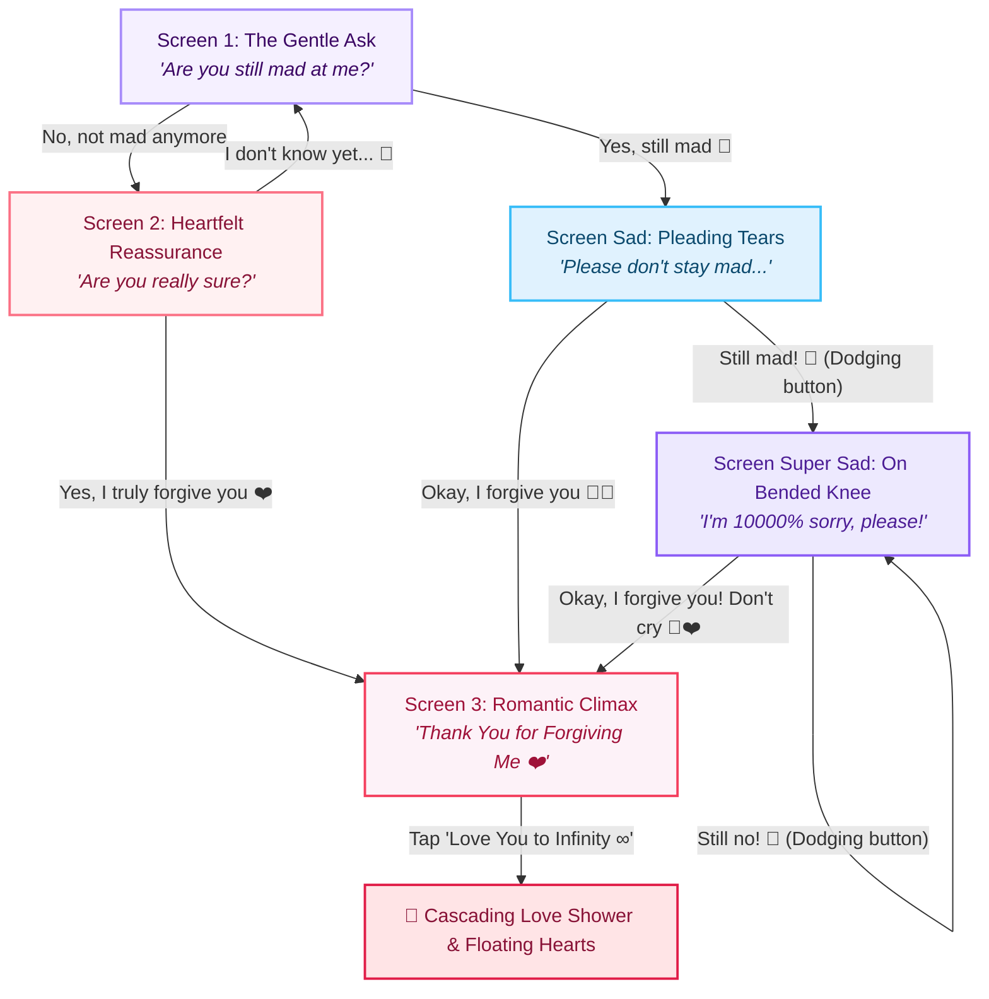

<div align="center">

# 🥺 Apology Card 💌

**A playful, interactive, and beautifully animated romantic apology web application.**  
*Crafted for creating viral Instagram Reels, TikToks, and heartwarming personal surprises.*

[](LICENSE)
[](script.js)
[](index.html)
[](style.css)
[](#-mobile-first--reels-ready)

<br />

[Explore Features](#-features) • [State Flow](#-interactive-flow-diagram) • [Quick Start](#-getting-started) • [Customization](#-customization-guide) • [Author](#-author)

</div>

---

## 🌟 Highlights

- **Zero Dependencies**: 100% pure vanilla HTML5, CSS3, and JavaScript — no Node.js, no bundler, no build steps required.
- **Dynamic Dodging Mechanics**: Refusal buttons playfully evade clicks and cursor hovers, cycling through emotional and funny pleading responses.
- **Adaptive Button Sizing**: The forgiveness button grows progressively larger and more inviting as the user tries to decline.
- **Cascading Love Shower**: An interactive background particle effect showering custom love notes, glowing sparkles, and floating hearts.
- **Immersive Multi-State Themes**: Each emotional stage features its own tailored color palette, customized SVG illustrations, and bespoke CSS entrance animations.

---

## 🔀 Interactive Flow Diagram

The application guides the visitor through a branching emotional journey:



---

## ✨ Screen-by-Screen Walkthrough

| Screen | Mood & Theme | Visual Elements | Interactive Behavior |
| :--- | :--- | :--- | :--- |
| **1. The Gentle Ask** | Soft Lavender Mist | Botanical foliage branches, garland, apology badge stickers | Initial question prompting if the user is still upset |
| **2. Reassurance** | Blush Rose & Romance | Heart-shaped corgi frame, cherry blossom petals, 3D typography | Confirmation step to guarantee forgiveness is sincere |
| **3. Pleading Tears** | Raindrop Twilight Blue | Melancholy rain clouds, animated teardrops, crying avatar | Triggered if user selects 'Yes'; emotional pleading button |
| **4. On Bended Knee** | Moonlit Deep Indigo | Weeping moon, bandage patches, dramatic plea styling | Refusal button begins evasion; forgiveness button expands |
| **5. Celebration Climax** | Warm Rose Gold & Confetti | Floating helium balloons, celebration garland, kissing corgis | Final romantic note with infinite love rain trigger |

---

## 📁 Repository Structure

```
Apology-Card/
├── gifs/
│   ├── pleading.gif          # Screen 1: Cute comedy bear pleading
│   ├── corgi.gif             # Screen 2: Adorable Welsh corgi puppy
│   ├── crying.gif            # Screen Sad: Emotional crying character
│   ├── zookiz.gif            # Screen Super Sad: Ppuyo bawling on bended knee
│   └── corgi-love.gif        # Screen 3: Corgi hugging and kissing celebration
├── .gitignore                # Clean development exclusion rules
├── index.html                # Semantic markup with embedded SVGs and meta tags
├── LICENSE                   # MIT Open Source License
├── README.md                 # Project documentation and showcase
├── script.js                 # State machine, evasion physics & particle effects
└── style.css                 # Modular CSS tokens, keyframe animations & responsive layout
```

---

## 🚀 Getting Started

### Local Setup (No Dependencies Required)

1. **Clone the repository:**
   ```bash
   git clone https://github.com/saklincodes/Apology-Card.git
   cd Apology-Card
   ```

2. **Run in your browser:**
   - Double-click `index.html` to open it directly in any browser.
   - Or launch with VS Code's **Live Server** extension for real-time live reload.

---

## 📱 Mobile-First & Reels Ready

This web application was specifically crafted with social media content creation in mind:

1. Open `index.html` on your mobile device or open Developer Tools (`F12`) and toggle device toolbar (`Ctrl + Shift + M`) set to **375×812** or **390×844** (9:16 aspect ratio).
2. Record your screen while clicking or tapping through the emotional options.
3. Show off the dodging refusal button and the final celebration climax.
4. Export the clip to Instagram Reels, TikTok, or YouTube Shorts and pair it with your favorite romantic audio track!

---

## 🎨 Customization Guide

You can easily personalize this card for your partner or friend:

- **Change Messages & Text**: Open [index.html](index.html) and modify the heading titles (`<h1>`) and subtitles (`<p class="apology-sub">`).
- **Personalize GIFs**: Replace any file in the `gifs/` folder with your own favourite animated characters or stickers.
- **Custom Love Rain Phrases**: Edit the `lovePhrases` array in [script.js](script.js) to add inside jokes, nicknames, or personal memories:
  ```javascript
  const lovePhrases = [
    "I love you so much! ❤️",
    "You are my favorite person ✨",
    "Best friends forever 🥺",
    "Always and forever 💕"
  ];
  ```

---

## 🛠️ Tech Stack & Architecture

- **Markup**: HTML5 with semantic tags, accessible ARIA attributes, and inline SVG vector assets.
- **Styling**: Vanilla CSS3 using CSS Custom Properties (tokens), 3D perspective transforms, flexbox, and GPU-accelerated keyframe animations.
- **Logic**: Modern ES6+ JavaScript utilizing state-driven DOM manipulation, dynamic bounding rect collision avoidance, and procedural particle generation.
- **Typography**: [Quicksand](https://fonts.google.com/specimen/Quicksand) (Clean Modern UI) & [Caveat](https://fonts.google.com/specimen/Caveat) (Playful Handwritten Accents).

---

## 🤝 Contributing

Contributions, feedback, and star ratings are warmly welcomed!

1. Fork the Project (`gh repo fork saklincodes/Apology-Card` or via GitHub UI).
2. Create your Feature Branch (`git checkout -b feature/CreativeNewFeature`).
3. Commit your Changes (`git commit -m "Add creative new animation feature"`).
4. Push to the Branch (`git push origin feature/CreativeNewFeature`).
5. Open a Pull Request.

---

## 📄 License

Distributed under the **MIT License**. See [`LICENSE`](LICENSE) for full details.

---

## 👤 Author

**saklincodes**
- GitHub: [@saklincodes](https://github.com/saklincodes)

<div align="center">
  <sub>Made with ❤️ and endless apologies. If this project brought a smile to your face, consider leaving a ⭐!</sub>
</div>
